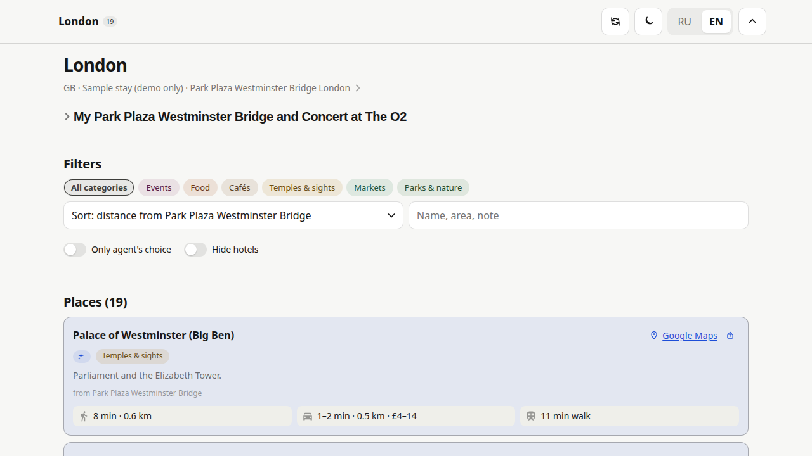
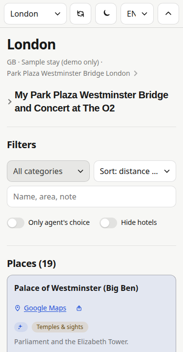

# PinKeepr

**Your own private trip page that works great on a phone.**

Put the places you want to see, where you want to eat, and the events you're going to on one page. For every place you see how far it is and how long it takes to get there from your starting point: a hotel, a friend's flat, an Airbnb, a train station during a layover, whatever you like. You can have several. Light or dark mode, English or Russian.

👉 **[See the live demo: demotrip.25h.me](https://demotrip.25h.me/)** (London, made-up data) · Project page: [pinkeepr.25h.me](https://pinkeepr.25h.me/)





*The screenshots show the London demo. All data in it is made up.*

---

## You don't need to be technical

You won't install anything, write code, or edit files. An **AI agent** (Claude Code, Codex, Grok, Hermes, or similar) does all of that for you. You just tell it what you want, in plain words.

### Step 1. Give your agent this message

Copy it as is:

```text
Set up my own travel site from https://github.com/mauzon/pinkeepr. Follow AGENTS.md end to end: fork to my account, deploy to my chosen host, load the London demo from https://github.com/mauzon/pinkeepr/tree/main/demo/london, keep trip data private, and maintain .travel/instance.json so you can manage the site later.
```

Don't want the demo? Change the end to **"deploy empty, no demo"**.

### Step 2. Answer a few questions

The agent will ask you to:

1. **Sign in to GitHub.** That's where your copy of the site lives. It's free, and it stays private.
2. **Pick a hosting service and sign in.** This is what puts your page on the internet. Cloudflare, Vercel, Netlify, or Railway all work. If you're not sure, pick Cloudflare.
3. **Decide who can open the page.** Anyone with the link, or only people whose email you list. Those people get a login code by email.
4. *(Optional)* **Use your own web address**, like `trips.yourname.com`.

### Step 3. Done

You get a link to your page. From then on, just tell the agent what to change. See the examples below.

### Why it's easier than chats and saved pins

The agent that set up your site keeps looking after it. To change something, you just talk to it, the way you'd talk to a friend helping you plan:

> *"We're staying at Anna's place instead of the hotel. Measure everything from there."*
> *"Drop the museums, we won't have time. Add a couple of breakfast spots near the station."*

- **No digging through old chats.** You don't have to scroll back to find what you decided about a place, and when. The site itself is the up-to-date answer, and everyone you share it with sees the same thing.
- **No hunting on the map.** You don't have to look up again where exactly your hotel or meeting point is. It's saved, and every distance is already measured from it.
- **Change your mind anytime.** You talk it through with the agent, it updates the page, and the page stays tidy.

> **Coming back later?** Start a new chat and say: *"This is my travel site repo: `<link to your copy>`. Read `.travel/instance.json` and continue."* The agent will pick up where you left off.

---

## Try the demo first

Not ready to add your own trip? Load a sample and see how the page works.

- **London**: 18 sights plus an example event. This is what's on the screenshots and at **[demotrip.25h.me](https://demotrip.25h.me/)**.
- **Lisbon** (`example`): a smaller sample trip.

Tell your agent:

```text
Load the London demo.
```

When you're ready for your real trip:

```text
Remove the demo data.
```

The demos use made-up data only, so they're safe to show anyone.

---

## Adding places from Google Maps

This is the quickest way to fill your page. If you already save places in Google Maps, you don't have to add them again one by one.

### Option A. Import a whole Google Maps list (best)

Works with your own lists and with **group lists your friends add places to**.

**1. Get the list link**

*On your phone (Google Maps app):*
1. Tap **You** (or **Saved**) at the bottom.
2. Open the list you want, for example "Lisbon 2027".
3. Tap **Share** (or **⋮ → Share list**).
4. If Google asks who can see the list, choose **anyone with the link**. Otherwise the agent can't read it.
5. Tap **Copy link**. You'll get something like `https://maps.app.goo.gl/AbC123xyz`.

*On a computer:* Google Maps → **Saved** → open the list → **Share** → turn on link sharing → **Copy link**.

**2. Send the link to your agent**

```text
Import my Google Maps list into the Lisbon trip:
https://maps.app.goo.gl/AbC123xyz
Use places within 30 km of the city center.
```

**3. What the agent does**

- Pulls in every place from the list, with its name, location, and Google Maps link.
- Keeps only the places near that city. One big list can cover several cities: each city just picks up its own places.
- Sorts places into categories (food, cafes, sights, parks, and so on).
- **Keeps your notes from Google Maps as they are.** The agent never overwrites them.
- **Opens the correct place in Maps** (CID / real `place_id` / your share link) — never a broken `place_id:/g/…` search.
- Works out travel times from your starting point to each place.
- Publishes the updated page.

**4. Added more places to the list later?**

Just say:

```text
Sync my Google Maps list again.
```

The agent adds the new places and shows you what changed. Your notes stay as they are.

**Good to know**

- The list link is saved only in **your private** copy of the project. Nobody else sees it.
- Your site keeps one "main" list that it can re-sync. You can import extra lists once with the same message. To re-sync another list later, just send its link again.
- If the agent says the list is empty or it can't open it, check the sharing setting from step 1.4.

### Option B. Add places one by one

Open a place in Google Maps, tap **Share → Copy link**, and send it to the agent:

```text
Add this restaurant to Lisbon, note "book a table": https://maps.app.goo.gl/XyZ789
```

You can send several links in one message.

### Option C. Set your starting point

This is where all distances and travel times are measured from. It doesn't have to be a hotel: it can be a friend's flat, an Airbnb, a train station where you change trains, a conference venue, anything. You can have several and switch between them on the page.

```text
In Lisbon we're staying at an Airbnb: https://maps.app.goo.gl/Flat123
Make it the main starting point.
```

```text
We have a 5-hour layover at Lisbon Oriente station. Add it as a second starting point.
```

You don't even need a link. A name or an address is enough, and the agent will find it.

---

## What else you can ask the agent

Write in normal sentences. English or Russian is fine.

| You say | What happens |
|---|---|
| Load the London demo so I can see how it looks. | A sample London trip appears. |
| Add Borough Market to London as a market, note "go hungry". | The place appears in the right category with your note. |
| Add these five restaurants. | All of them are added under food. |
| The concert at The O2 is on 15 March 2027 at 7:30 pm. Add it as an event and a starting point. | The concert appears under events, and you also see distances from the venue. |
| Change Borough Market to the food category. | The place moves to that category. |
| Remove Borough Market. | The place is removed. |
| Make my hotel the default starting point. | Distances are measured from the hotel by default. |
| We moved to a friend's flat at Rua X 12. Use it instead of the hotel. | The new starting point replaces the old one, and all distances are recalculated. |
| Remove the whole Lisbon trip. | That city is removed from the page. |
| Remove the demo data. | The sample data is cleared. |
| Add my partner's email so they can open the site. | That person can now log in. |
| Run a security audit of my travel site. | The agent checks the site for privacy and security issues and tells you what to fix. |

**Place types:** sights, museums, parks, food, cafes, bars, markets, shopping, spa, nightlife, events, hotels, coworking, activities.

There's no "favourite" or "visited" button. Just ask the agent to add a note like "must visit" or "been there".

---

## How much it costs

Usually **nothing**, for a personal trip site.

- **GitHub:** free, including private projects.
- **Hosting:** the free plans at Cloudflare, Netlify, and Vercel are plenty. Railway gives you trial credit.
- **Email login:** Cloudflare Access is free for a small group of people.
- **This project:** free, no subscription.

---

## For developers

The full agent runbook (fork → deploy → domain → access → data → maintenance) is in **[AGENTS.md](AGENTS.md)**. It's the single source of truth, and the agent follows it.

**Quick start**

```bash
npm ci
npm run demo:london   # optional: load the London demo
npm run validate
npm run build         # static site → dist/
npm run test:browser  # optional Playwright smoke test
```

**Demo packs:** each pack is a folder with `pack.json` (manifest) and city JSON files. An agent can apply a pack straight from a GitHub link, without running scripts. Details: [`demo/README.md`](demo/README.md).

| Command | What it does |
|---|---|
| `npm run demo -- london` | Load `demo/london/` (18 sights + event) |
| `npm run demo -- example` | Load the Lisbon sample |
| `npm run demo -- <https-url>` | Load a pack from a GitHub tree/blob/raw URL |
| `npm run demo -- remove london` | Remove only that pack's files and cities |
| `npm run demo -- clear` | Clear all city data and reset config |
| `npm run demo:london` / `demo:clear` | Shortcuts |

A fresh clone has no trip data and builds an empty landing page until a pack or city is loaded.

**Deploy:** Node 22, build `npm ci && npm run build`, output `dist/`. The configs are already in the repo: `wrangler.jsonc` (Cloudflare Workers), `vercel.json`, `netlify.toml`, `railway.json` + `serve.json` (Railway, `npm start`).

[](https://deploy.workers.cloudflare.com/?url=https://github.com/mauzon/pinkeepr)
[](https://railway.com/new/github)

**Where things live**

| Path | What it is |
|---|---|
| `config.json` | Site title, language, city list, `googleList` (main Google Maps list) |
| `data/cities/<slug>.json` | One city: origins, places, events, routes |
| `data/schema/` | JSON Schemas (city, pack, instance) |
| `demo/` | Demo packs (`london`, `example`), see [`demo/README.md`](demo/README.md) |
| `scripts/` | validate, demo, add-origin, enrich-routes, enrich-transit, extract/sync list, remove-*, audit |
| `src/` | React UI, `src/i18n/` for EN/RU strings |
| `.travel/instance.json` | Deployment state for the agent (gitignored, no secrets) |

**Google Maps list pipeline:** `scripts/extract-list.mjs <url>` → `scripts/filter-city.mjs` → `scripts/merge-city.mjs`; re-sync with `npm run sync-list` (dry run) / `-- --apply`. Places from a list get `source: "list"`, and `user_note` is never overwritten. Details: AGENTS.md Phase 5b.

**Maps links:** List imports capture feature ids → CID; the site never emits `place_id:/g/…`. See [docs/google-maps-links.md](docs/google-maps-links.md). Verify with `npm run check:maps-links`.

**Security:** CSP and headers live in `scripts/lib/security-headers.mjs`. `npm run audit:security` writes a report to `reports/`. Every external link must be https (checked by `validate`).

## Customization

**Icons & PWA:** default branding uses the suitcase emoji (🧳, U+1F9F3) from Twemoji, generated into `public/` (`favicon.svg`, `favicon.ico`, `apple-touch-icon.png`, `icon-192.png`, `icon-512.png`, maskable variant, `site.webmanifest`). Regenerate with `node scripts/generate-icons.mjs` (needs Python Pillow). `npm run build` copies `public/` into `dist/` and links icons in every HTML `<head>`. The top bar **Reload** button (iOS standalone PWA) clears Cache Storage and service workers, then reloads with a fresh `?v=` timestamp; HTML is served with `Cache-Control: no-cache`.

**Offline use:** `npm run build` emits `dist/sw.js` (versioned precache of all HTML routes, icons, manifest, and `data/cities/*.json`). After the first online visit, the installed PWA opens your place list, filters, and cards without a network. **Google Maps** links and map tiles still need the internet. On access-protected hosts (Cloudflare Access), if login redirects or 401/403 responses appear, the service worker serves the last cached HTML instead so the trip page still loads. Check with `npm run test:offline`.

## License

MIT, see [LICENSE](LICENSE).
